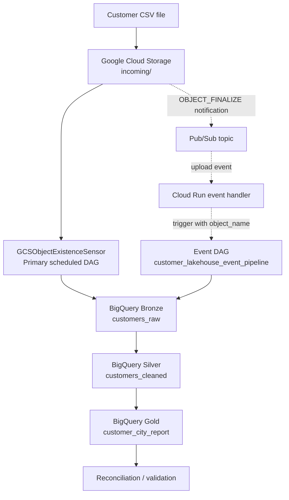
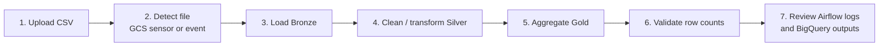

<div align="center">

# ☁️ CloudPulse
### GCP Customer Data Lakehouse

**An Infrastructure-as-Code data engineering project with sensor-based ingestion, event-driven processing, and Bronze → Silver → Gold analytics.**


</div>

---

## 📌 Project at a glance

CloudPulse is a GCP data lakehouse demo that ingests customer CSV data from Cloud Storage, orchestrates processing with Cloud Composer (managed Apache Airflow), and creates analytics-ready tables in BigQuery.

> **⭐ Key feature: Google Cloud Storage sensor.** The primary scheduled DAG uses `GCSObjectExistenceSensor` to wait for the configured CSV object before proceeding. This makes file readiness an explicit orchestration step instead of immediately attempting ingestion. A separate event-triggered DAG is also included to demonstrate a Pub/Sub-based upload event workflow.

### What this project demonstrates

- Provisioning GCP resources using Terraform.
- Orchestrating data processing with Cloud Composer / Apache Airflow.
- **Sensor-based file detection** with `GCSObjectExistenceSensor`.
- An event-driven extension using Cloud Storage object-finalize notifications, Pub/Sub, and an event DAG.
- BigQuery Bronze, Silver, and Gold layers.
- SQL transformations and row-count reconciliation.
- Evidence-based validation using Airflow run history, task logs, and BigQuery query results.

## 🏗️ Architecture



**Architecture note:** The sensor DAG and event-driven DAG are separate execution paths. The sensor DAG is scheduled and waits for the configured object; the event DAG is unscheduled and expects an uploaded object name in its DAG-run configuration. The event-driven path requires the Pub/Sub consumer / Cloud Run handler to be deployed and configured for automatic upload-to-DAG triggering.

## 🔁 Data flow



1. Upload a CSV object into the configured `incoming/` path in Cloud Storage.
2. The primary DAG's `wait_for_csv` task checks for the object using `GCSObjectExistenceSensor`.
3. Load the raw input into the Bronze BigQuery table.
4. Transform and clean data into Silver.
5. Aggregate customer analytics into Gold.
6. Run reconciliation checks and inspect task status/logs.
7. Validate output counts and query results in BigQuery.

## ⭐ Featured capability: GCS sensor

The main project emphasis is the **`GCSObjectExistenceSensor`** in `customer_lakehouse_sensor_pipeline`.

- **Task ID:** `wait_for_csv`
- **Object checked:** `incoming/customers.csv` (default configured object)
- **Sensor polling:** configured to check periodically while the task is active.
- **Purpose:** wait for the target object to exist before allowing downstream ingestion to run.
- **Downstream tasks:** `load_bronze` → `build_silver` → `build_gold` → `validate_reconciliation`.

A sensor's `poke_interval` is the interval between checks during an active DAG run; it is **not** the schedule interval for starting the DAG. The sensor DAG's schedule is configured separately in the DAG definition.

### Sensor execution evidence


## ⚡ Event-driven extension

The repository also includes `customer_lakehouse_event_pipeline`, an unscheduled DAG intended to receive an uploaded object name through `dag_run.conf` and process that specific CSV.

The intended event path is:

1. Cloud Storage emits an `OBJECT_FINALIZE` notification.
2. Pub/Sub receives the notification.
3. A consumer such as Cloud Run parses the event and triggers the event DAG with the object name.
4. The event DAG validates the path and runs Bronze → Silver → Gold → reconciliation.

The screenshots document the event DAG and Pub/Sub resources. **Automatic triggering only works when the Pub/Sub subscription consumer/Cloud Run handler and its IAM/API configuration are deployed and connected.** Creating a topic or notification alone does not trigger Airflow.


## 🧱 Data layers

| Layer | Purpose | Example table |
|---|---|---|
| **Bronze** | Raw ingested source records | `customer_bronze_dev.customers_raw` |
| **Silver** | Cleaned / standardized customer records | `customer_silver_dev.customers_cleaned` |
| **Gold** | Aggregated analytics for reporting | `customer_gold_dev.customer_city_report` |

The screenshots show one successful test run with **10 Bronze rows, 10 Silver rows, and 4 Gold city-level rows**. Results depend on the uploaded input CSV.


## 🧰 Tools and services

- **Google Cloud Storage** — raw CSV landing zone and object-finalize event source.
- **Cloud Composer / Apache Airflow** — workflow scheduling, sensors, task orchestration, and run monitoring.
- **BigQuery** — Bronze, Silver, and Gold datasets and SQL transformations.
- **Pub/Sub** — message topic for Cloud Storage upload notifications.
- **Cloud Run** — intended event consumer / Airflow trigger service for the event-driven path.
- **Terraform** — infrastructure provisioning and configuration.
- **Python** — DAG logic, validation, and event handler code.
- **SQL** — Silver cleaning and Gold aggregation.
- **Git / GitHub** — version control and project documentation.

## 📁 Repository structure

```text
cloudpulse-gcp-customer-lakehouse/
├── .github/                   # GitHub workflows / repository automation
├── cloudrun/                  # Event consumer / trigger handler
├── dags/
│   ├── customer_lakehouse_sensor_pipeline.py
│   └── customer_lakehouse_event_pipeline.py
├── data/                      # Sample CSV data
├── docs/
│   ├── screenshots/            # Numbered execution evidence
│   └── architecture.md
├── sql/                       # SQL transformations and queries
├── terraform/
│   ├── environments/dev/
│   └── modules/
├── tests/                     # Tests and validation
├── requirements.txt
├── requirements-dev.txt
├── .gitignore
├── LICENSE
└── README.md
```

## 🚀 Setup and deployment

> **Cost warning:** Cloud Composer can incur significant charges while running. Use a development project, monitor billing, and destroy resources when you have finished testing if you no longer need them.

### Prerequisites

- A Google Cloud project with billing enabled.
- `gcloud` CLI authenticated to the target project.
- Terraform installed.
- Python installed for local tests.
- IAM permissions to enable APIs and create the required resources.

### 1. Clone the repository

```bash
git clone https://github.com/cloudwithpavan/cloudpulse-gcp-customer-lakehouse.git
cd cloudpulse-gcp-customer-lakehouse
```

### 2. Configure Google Cloud

```bash
gcloud auth login
gcloud auth application-default login
gcloud config set project YOUR_PROJECT_ID
```

### 3. Configure Terraform variables

Review `terraform/environments/dev/terraform.tfvars.example` if present, or create your local `terraform.tfvars` based on the variables declared by the environment. Set your project ID, region, dataset location, and deployment options. Do **not** commit credentials, state files, or your private `terraform.tfvars`.

### 4. Initialize and validate Terraform

```powershell
Set-Location terraform/environments/dev
terraform init
terraform fmt -recursive
terraform validate
terraform plan
```

Review the plan carefully before applying. Check especially for changes to existing Cloud Storage objects and Composer resources.

### 5. Apply infrastructure

```powershell
terraform apply
```

Type `yes` only after reviewing the plan. Terraform may enable APIs, create storage and BigQuery resources, provision Composer, and upload DAG files depending on the environment variables and configuration.

### 6. Verify the sensor DAG

1. Open the Cloud Composer environment in the Google Cloud Console.
2. Open the Airflow UI and locate `customer_lakehouse_sensor_pipeline`.
3. Confirm the DAG is active.
4. Upload the expected CSV object into the configured `incoming/` location.
5. Trigger a run or wait for the configured schedule.
6. Open the run graph and confirm `wait_for_csv`, `load_bronze`, `build_silver`, `build_gold`, and `validate_reconciliation` succeed.
7. Query BigQuery to verify the results.

### 7. Verify the event-driven DAG

1. Confirm the Pub/Sub topic and Cloud Storage notification exist.
2. Confirm the event consumer / Cloud Run service is deployed and subscribed to the topic.
3. Confirm the service account can receive Pub/Sub messages and trigger the Airflow DAG.
4. Upload a new CSV and check Cloud Run / Pub/Sub logs.
5. Open `customer_lakehouse_event_pipeline` and verify the run configuration contains the expected `object_name`.
6. Validate downstream task status and BigQuery outputs.

### 8. Run tests

```powershell
Set-Location ..\..\..
python -m pip install -r requirements-dev.txt
python -m pytest
```

Adapt test commands to the actual test configuration in the repository.

## 🔎 Validation and output evidence

The `docs/screenshots/` folder contains numbered screenshots from the working GCP console and Airflow UI, including:

- Airflow DAG list and status.
- Sensor run summary and task graph.
- Sensor task logs.
- Pub/Sub subscription / notification evidence.
- Event DAG details and diagram.
- BigQuery query results.

Use the evidence to understand the implemented path; the screenshots are point-in-time results, not a guarantee that deployed cloud resources are still active.

## 🔐 Security and cost notes

- Never commit service-account JSON keys, access tokens, `.terraform/`, Terraform state files, local plan files, or private `.tfvars`.
- Keep Cloud Storage buckets private and grant least-privilege IAM roles.
- Review event handler authentication and Airflow API permissions before exposing a service endpoint.
- Delete unused resources after testing, but inspect dependencies and Terraform state before destroying anything.

## 👤 Author

**Pavan Kumar**  
GitHub: [@cloudwithpavan](https://github.com/cloudwithpavan)

---

<div align="center">

**CloudPulse — From CSV landing to analytics-ready customer insights.**

</div>
