<div align="center">

# ☁️ CloudPulse
### GCP Customer Data Lakehouse

**A production-style data engineering portfolio project on Google Cloud**


**Terraform · Cloud Storage · Cloud Composer · Apache Airflow · BigQuery · Pub/Sub · Cloud Run**

</div>

---

## ✨ Project at a glance

CloudPulse demonstrates an end-to-end customer-data lakehouse on Google Cloud. CSV files land in **Google Cloud Storage (GCS)**, Apache Airflow orchestrates processing, and BigQuery stores the **Bronze → Silver → Gold** layers. The primary workflow features a **GCS object-existence sensor**; a separate event-driven path demonstrates GCS notifications flowing through Pub/Sub and Cloud Run to an Airflow event DAG.

<table>
<tr><td><strong>🎯 Primary capability</strong></td><td>Sensor-based file detection with <code>GCSObjectExistenceSensor</code></td></tr>
<tr><td><strong>🏗️ Infrastructure</strong></td><td>Terraform-managed Google Cloud resources</td></tr>
<tr><td><strong>🔄 Data processing</strong></td><td>Bronze raw ingestion → Silver cleaned records → Gold city-level report</td></tr>
<tr><td><strong>✅ Validation evidence</strong></td><td>Previously observed run: 10 Bronze rows, 10 Silver rows, 4 Gold rows</td></tr>
<tr><td><strong>⚡ Extension</strong></td><td>GCS <code>OBJECT_FINALIZE</code> → Pub/Sub → Cloud Run → event DAG</td></tr>
</table>

> **Evidence note:** screenshots are point-in-time evidence from the project run. They do not guarantee that cloud resources are still running. The 10 / 10 / 4 counts describe the captured test run and may change with new input data.

## 🏛️ Architecture

### 1. Main sensor-based lakehouse path

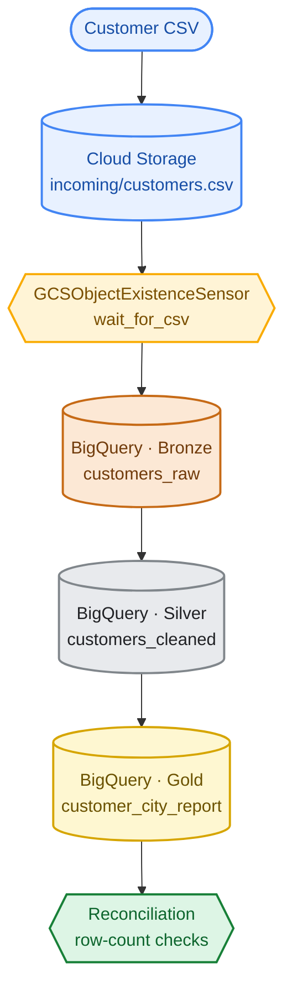
## 📁 Repository structure

```text
cloudpulse-gcp-customer-lakehouse/
├── .github/
├── cloudrun/                         # Event handler / trigger service
├── dags/                             # Sensor and event DAGs
├── data/                             # Sample CSV data
├── docs/
│   ├── architecture.md
│   └── screenshots/                  # Inline README evidence (20 named images)
├── sql/                              # SQL transformations / queries
├── terraform/                        # Environments and reusable modules
├── tests/
├── requirements.txt
├── requirements-dev.txt
├── .gitignore
├── LICENSE
└── README.md
```

### 2. Event-driven extension

```mermaid
flowchart LR
    GCS[(GCS object finalized)] -->|OBJECT_FINALIZE| TOPIC{{Pub/Sub topic}}
    TOPIC --> SUB[Pub/Sub subscription]
    SUB --> RUN[Cloud Run trigger handler]
    RUN -->|object_name in DAG config| DAG[Unscheduled event DAG]
    DAG --> BQ[(BigQuery Bronze → Silver → Gold)]
    BQ --> CHECK{{Reconciliation}}
    classDef gcp fill:#E8F1FF,stroke:#4285F4,color:#174EA6,stroke-width:2px;
    classDef event fill:#F3E8FD,stroke:#9334E6,color:#5B168A,stroke-width:2px;
    classDef output fill:#DDF5E5,stroke:#188038,color:#0D652D,stroke-width:2px;
    class GCS,BQ gcp;
    class TOPIC,SUB,RUN,DAG event;
    class CHECK output;
```

The scheduled sensor DAG and unscheduled event DAG are **separate execution paths**. The sensor's `poke_interval` is the wait between checks during an active run; it is not the DAG's schedule. Automatic event triggering depends on the notification, subscription delivery, Cloud Run handler, IAM permissions, and Airflow trigger request all being correctly configured.

## 🔁 Pipeline walkthrough

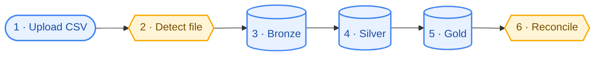

1. Upload a customer CSV to the configured GCS `incoming/` path.
2. Start or wait for a run of `customer_lakehouse_sensor_pipeline`.
3. `wait_for_csv` checks for the configured object (default: `incoming/customers.csv`).
4. `load_bronze` ingests the source data.
5. `build_silver` applies the cleaning / standardization logic.
6. `build_gold` creates the city-level reporting output.
7. `validate_reconciliation` compares layer row counts; review the task logs and BigQuery output.

## 🪣 Cloud Storage input evidence

The raw CSV is stored in the GCS bucket under the `incoming/` prefix. The screenshots below show the infrastructure overview and input object used in the workflow.


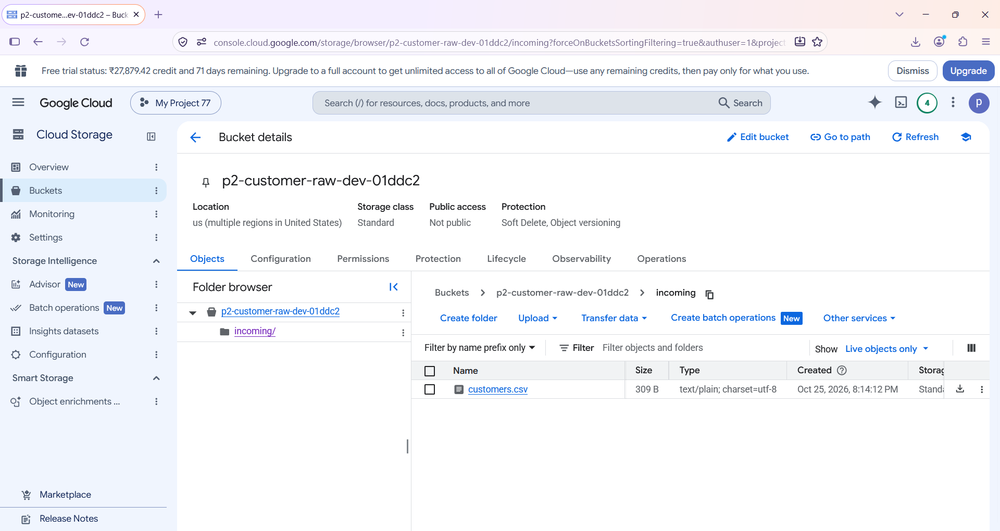


## ⭐ Main feature: GCS sensor

The primary DAG is `customer_lakehouse_sensor_pipeline`. Its sensor task, `wait_for_csv`, prevents downstream ingestion from starting until the configured object exists. The downstream sequence is `load_bronze` → `build_silver` → `build_gold` → `validate_reconciliation`.

### Evidence from Airflow

**Cloud Composer environment**


**Airflow DAG list**


**GCS sensor task graph**

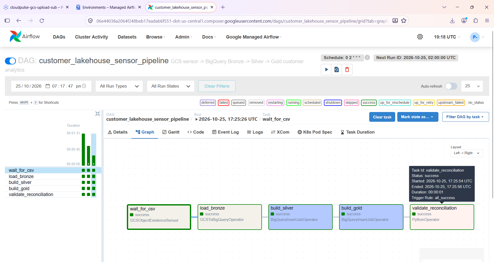

**Full pipeline graph with sensor**

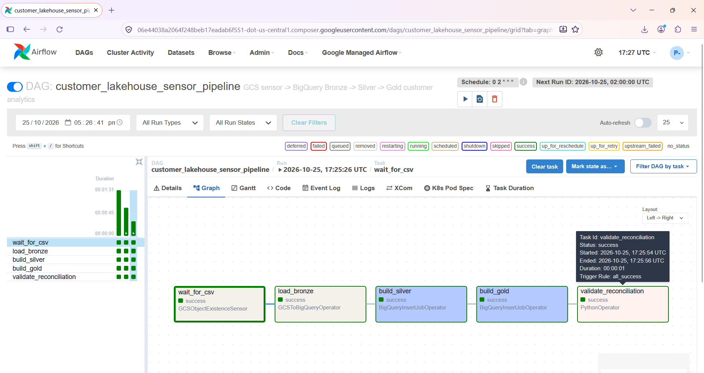

**Successful sensor pipeline**

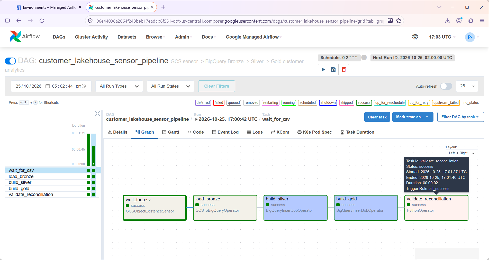

**Sensor waiting for the input file**

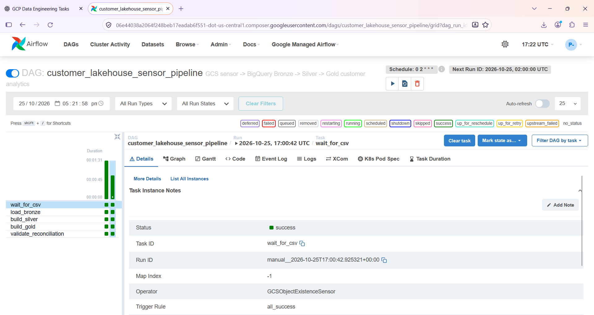

**Sensor task succeeded**

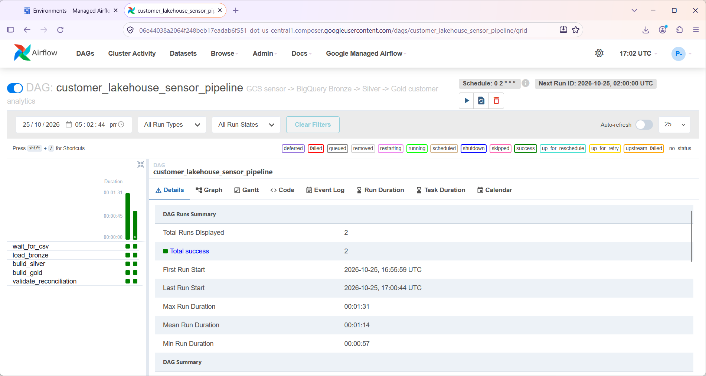

**Logs confirming file detection**


## 🧊 BigQuery: Bronze → Silver → Gold

| Layer | Purpose | Example table | Evidence result from captured run |
|---|---|---|---:|
| 🟤 **Bronze** | Raw ingested customer records | `customer_bronze_dev.customers_raw` | 10 rows |
| ⚪ **Silver** | Cleaned / standardized customer records | `customer_silver_dev.customers_cleaned` | 10 rows |
| 🟡 **Gold** | City-level analytics / reporting | `customer_gold_dev.customer_city_report` | 4 rows |

### Bronze output — raw records

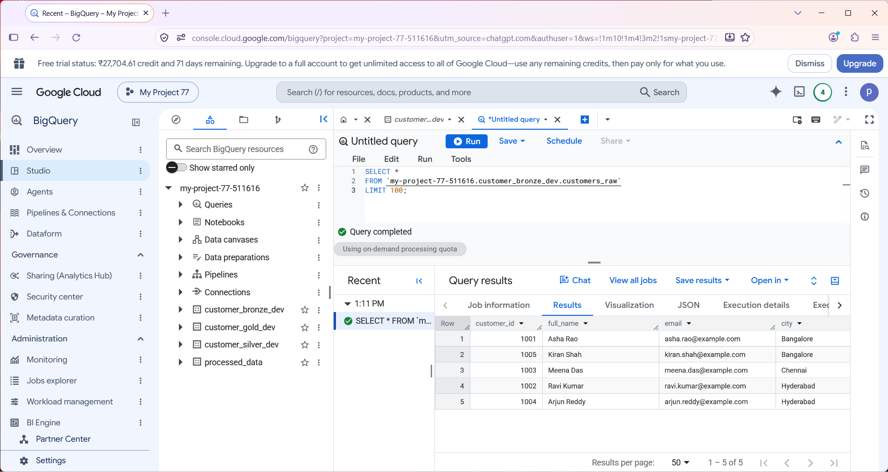

### Silver output — cleaned records

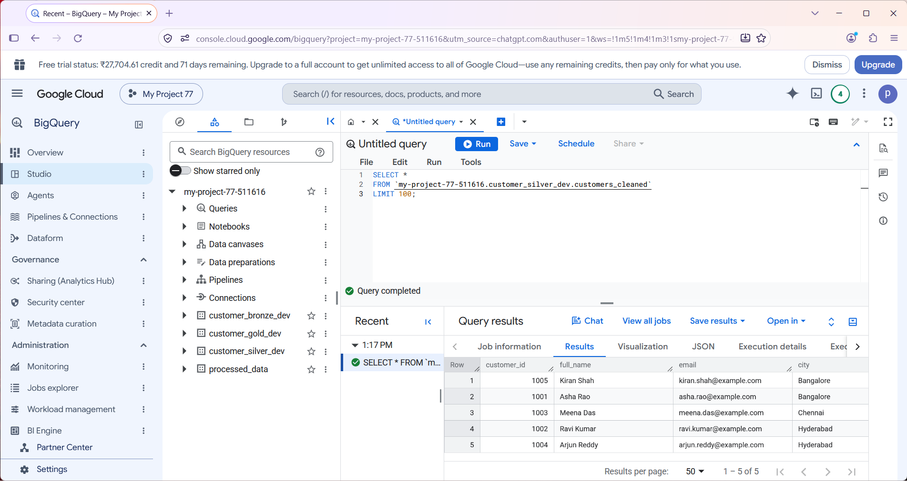

### Gold output — city aggregation

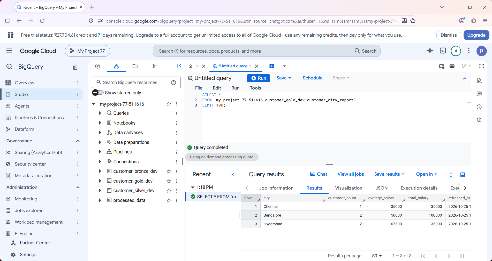

### Reconciliation output

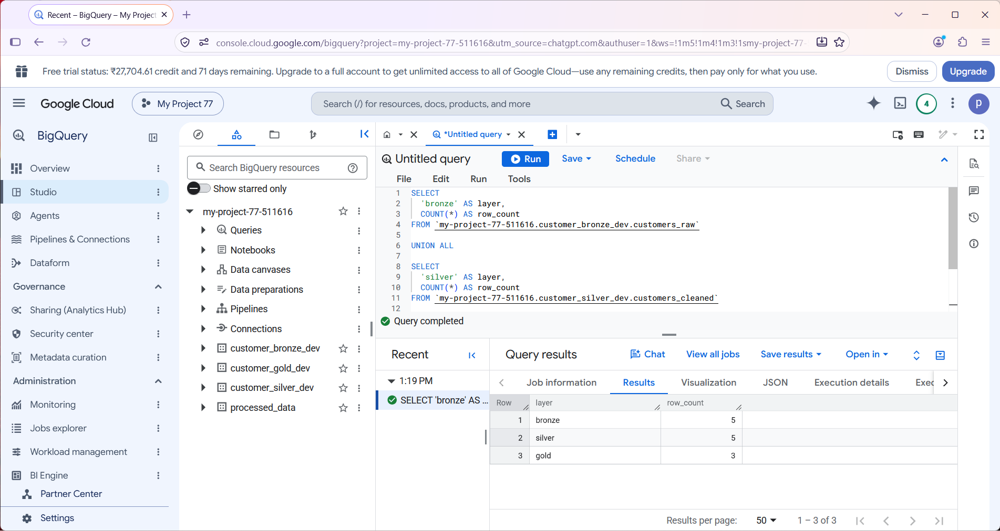

The reconciliation screenshot is separate from the three table-output screenshots: it shows the counts for all layers together. Use the table-output screenshots to inspect individual records and the reconciliation screenshot to validate counts.

## ⚡ Event-driven pipeline evidence

The event DAG, `customer_lakehouse_event_pipeline`, is designed to accept an uploaded object name through `dag_run.conf`, validate the object path, and process that CSV. The intended event route is GCS `OBJECT_FINALIZE` → Pub/Sub → Cloud Run → Airflow event DAG.

**Pub/Sub subscription**

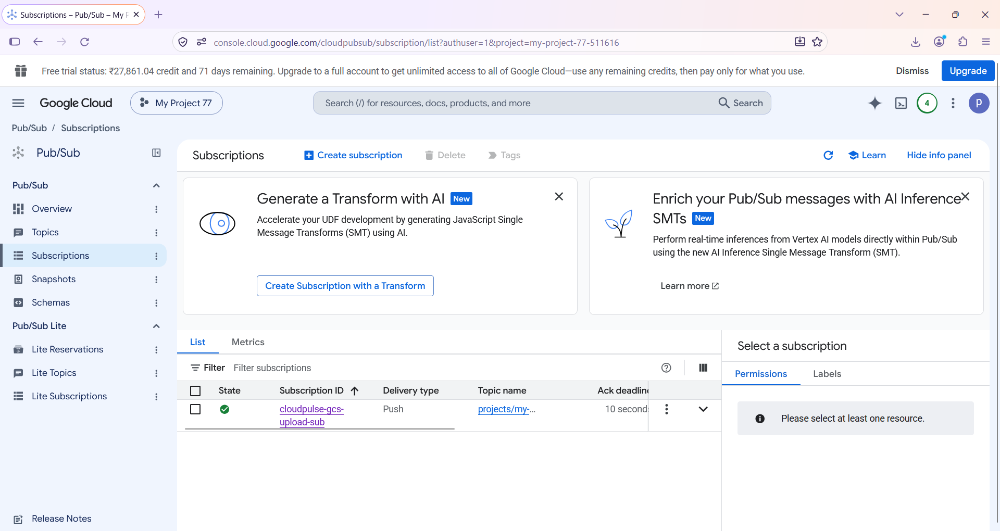

**Cloud Run trigger logs**

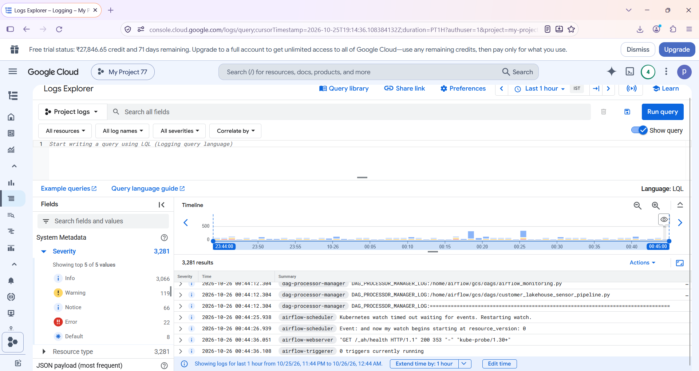

**Event pipeline task diagram**

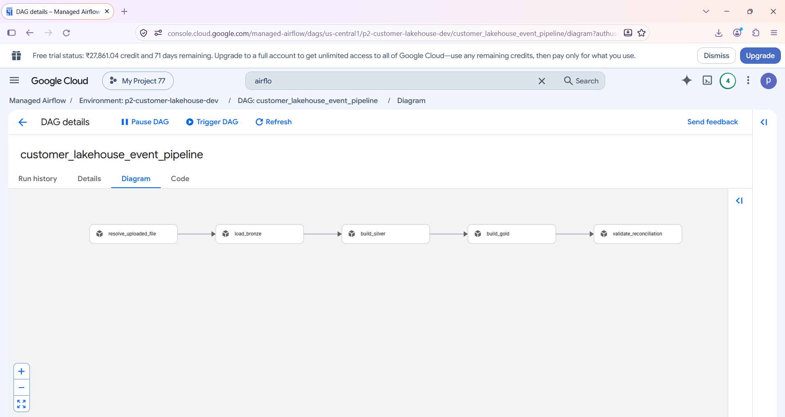

**Event pipeline run details**

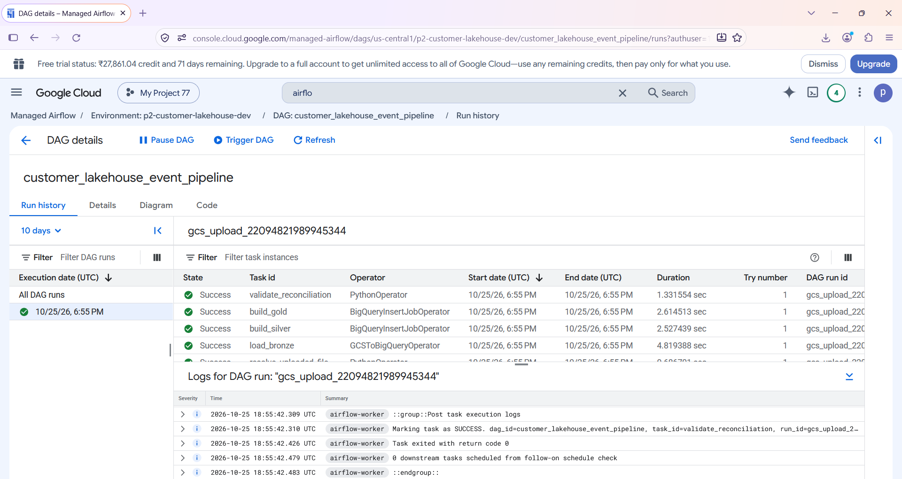

**Successful event DAG run**

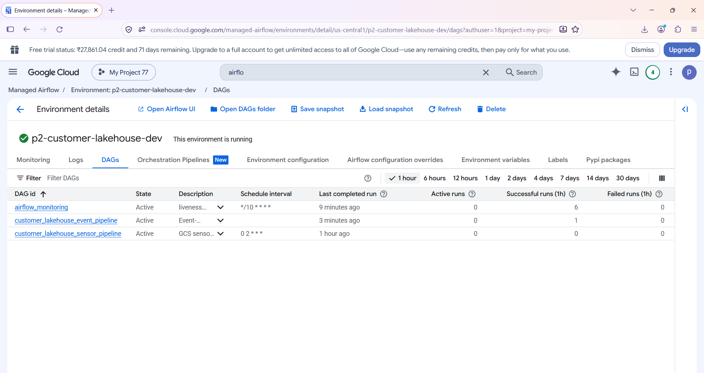


## 🧰 Technology stack

| Technology | Role in this project |
|---|---|
| **Google Cloud Storage** | Raw CSV landing zone and object-finalize event source |
| **Cloud Composer / Apache Airflow** | DAG scheduling, sensor-based file detection, orchestration and logs |
| **BigQuery** | Bronze, Silver and Gold storage and SQL transformations |
| **Pub/Sub** | Delivery of GCS object notifications |
| **Cloud Run** | Event handler intended to trigger the event DAG |
| **Terraform** | Infrastructure as code |
| **Python** | DAG logic, validation and event handler |
| **SQL** | Cleaning, aggregation and reconciliation |
| **Git / GitHub** | Source control and documentation |


## 🚀 Setup and run

> **Cost warning:** Cloud Composer can incur significant charges while running. Enable only the resources needed for testing, monitor billing, and remove unused infrastructure when finished. Review Terraform's plan carefully before applying or destroying resources.

### Prerequisites

- A Google Cloud project with billing enabled and appropriate IAM permissions.
- Google Cloud CLI (`gcloud`) authenticated.
- Terraform installed.
- Python installed for local tests.

### 1. Clone the repository

```bash
git clone https://github.com/cloudwithpavan/cloudpulse-gcp-customer-lakehouse.git
cd cloudpulse-gcp-customer-lakehouse
```

### 2. Authenticate and select a project

```bash
gcloud auth login
gcloud auth application-default login
gcloud config set project YOUR_PROJECT_ID
```

### 3. Configure Terraform

Move into `terraform/environments/dev`, review the variables and provide a local `terraform.tfvars` based on the variable definitions / example file available in the repository. Set the project, region, dataset location, and deployment toggles appropriate for your environment. Never commit private `.tfvars`, credentials, state files, or local plan files.

### 4. Initialize and validate

```powershell
Set-Location terraform/environments/dev
terraform init
terraform fmt -recursive
terraform validate
terraform plan
```

Inspect the plan carefully, particularly changes to Cloud Composer, existing GCS objects, IAM and billing-sensitive resources.

### 5. Apply infrastructure

```powershell
terraform apply
```

Review the proposed changes before confirming. Resources created depend on the Terraform configuration and deployment variables.

### 6. Validate the sensor pipeline

1. Open the Cloud Composer environment and Airflow UI.
2. Locate and enable `customer_lakehouse_sensor_pipeline` if needed.
3. Ensure the expected object is available at `incoming/customers.csv`, or update the DAG configuration to match the input.
4. Trigger a run or wait for the configured schedule.
5. Inspect the sensor logs and confirm all downstream tasks succeed.
6. Run queries against the Bronze, Silver and Gold tables.

### 7. Validate the event-driven path

1. Confirm the GCS notification, Pub/Sub topic and subscription exist.
2. Confirm the Cloud Run handler is deployed and can receive Pub/Sub messages.
3. Confirm IAM permissions and the Airflow DAG-trigger request are configured.
4. Upload a CSV and inspect Cloud Run logs and the event DAG run configuration.
5. Verify the event DAG's task statuses and BigQuery results.

### 8. Run local tests

```powershell
python -m pip install -r requirements-dev.txt
python -m pytest
```

Adjust the test command if the repository's test configuration differs.

## 🔐 Security, cost and operational notes

- Do not commit service-account keys, tokens, `.terraform/`, Terraform state, plan files, or private `.tfvars`.
- Keep buckets private and grant least-privilege IAM permissions.
- Review authentication and permissions before exposing an event-trigger endpoint.
- Composer is a managed service with ongoing cost; delete unused environments only after reviewing dependencies and Terraform state.
- The sensor DAG and event DAG are distinct workflows; the existence of a Pub/Sub topic alone does not guarantee automatic DAG triggering.

# ⭐ Support

If you find this project useful, consider **starring the repository**.

---

# 👨‍💻 Author

**Pavan Kumar Gummadi**

Data Engineer | Bigquery | gooogle cloud | Terraform | Airflow

GitHub
https://github.com/cloudwithpavan

Email
[pavan7071@gmail.com](mailto:pavan7071@gmail.com)

---

<div align="center">

**CloudPulse — From CSV landing to analytics-ready customer insights.**

</div>
