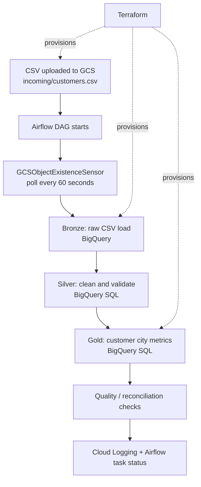

# CloudPulse — GCP Customer Data Lakehouse

**Author:** Gummadi Pavan Kumar  
**Cloud:** Google Cloud Platform  
**Orchestration:** Cloud Composer (Apache Airflow)  
**Infrastructure:** Terraform  
**Warehouse:** BigQuery  
**Architecture:** Bronze → Silver → Gold  
**Deployment scope:** dev environment only  
**Input:** CSV in Google Cloud Storage

> This repository is a production-style learning project. It includes environment configuration patterns, validation, CI checks, and operational guidance, but it is not a substitute for your organisation's security review, release approvals, SLOs, and data governance process.

## Architecture



## Repository layout

```text
dags/                         Airflow DAG with GCS sensor and three-layer pipeline
data/customers.csv            Synthetic demo data only
sql/                          Standalone layer SQL and verification queries
terraform/modules/             Reusable storage, BigQuery and Composer modules
terraform/environments/dev/     The only deployment environment in this project
tests/                          Local data-quality tests
.github/workflows/ci.yml        CI checks for Python, CSV and Terraform formatting
docs/                           Architecture and operational runbook
```

## Environment strategy: dev only

This project intentionally deploys **one dev environment**. The three data layers—Bronze, Silver and Gold—are datasets inside this dev environment. Pre-prod and prod are out of scope for this version.

To control costs, review the Terraform plan before applying. Cloud Composer is a paid managed service and can continue to incur charges while idle. The sample file is uploaded by Terraform so the first DAG run can pass the GCS sensor. The sensor only waits during an active DAG run; it does not trigger a run just because a file arrives.

## Prerequisites

- Google Cloud project ID: `my-project-77-511616`
- Billing enabled and permission to enable APIs/create service accounts/IAM/Composer/BigQuery/GCS resources.
- Google Cloud CLI, Terraform, Git and Python installed locally.
- Terraform state is stored locally for the initial workflow; no separate bootstrap or pre-existing state bucket is required. Back up the state file securely and never commit it.
- Region defaults: Composer `us-central1`; GCS and BigQuery location `US`.

**Cost warning:** Cloud Composer can be expensive while idle. Review the estimate and `terraform plan` before applying. Configure a budget alert in Cloud Billing; alerts do not automatically stop charges. Destroy the dev environment when finished.

## 1. Configure credentials (PowerShell)

From the repository root:

```powershell
gcloud auth login
gcloud config set project my-project-77-511616
gcloud auth application-default login
gcloud config get-value project
```

Check the active account and project before deploying.

## 2. Standard Terraform workflow (local state)

This version uses Terraform's default **local state** so you can use the standard commands you requested without a bootstrap directory or setup script. Terraform creates the new GCS data bucket, BigQuery datasets, IAM resources, and (only when enabled) Cloud Composer.

From the repository root, create your dev variables file:

```powershell
Copy-Item .\terraform\environments\dev\terraform.tfvars.example .\terraform\environments\dev\terraform.tfvars
```

Check `project_id` is `my-project-77-511616`. Keep `deploy_composer = false` for the first plan to avoid unexpected Composer charges. Then run:

```powershell
cd terraform\environments\dev
terraform init
terraform fmt -check -recursive ..\..\..
terraform validate
terraform plan -out=cloudpulse-dev.tfplan
terraform show cloudpulse-dev.tfplan
```

Review the plan. If it includes only the expected resources and you are ready to create them, run:

```powershell
terraform apply cloudpulse-dev.tfplan
```

This creates the raw data bucket, BigQuery Bronze/Silver/Gold datasets, APIs and IAM, but does **not** create Composer while `deploy_composer = false`. To deploy Composer later, edit `terraform.tfvars`, set `deploy_composer = true`, and run `terraform plan` and review the cost-sensitive changes before applying.

Terraform state is stored in `terraform\environments\dev\terraform.tfstate`. Keep it safe and backed up; it can contain sensitive metadata. Never commit state, plans, `terraform.tfvars`, credentials, or real customer data. This workflow can later migrate state to a GCS backend if desired, after creating a state bucket separately.

## 3. Run the pipeline

1. Wait for Terraform apply to complete.
2. Read the `composer_airflow_uri` output and open the Airflow UI.
3. Find `customer_lakehouse_sensor_pipeline`.
4. Trigger the DAG manually.
5. The GCS sensor checks for `incoming/customers.csv`, polling about every 60 seconds for up to 1 hour.
6. Once the sensor succeeds, the DAG loads Bronze, creates Silver, creates Gold, then checks row counts.
7. Confirm all tasks are green before proceeding.

Terraform uploads a synthetic sample CSV by default, so the first run should find the file. To test actual waiting behavior, delete the uploaded object in the GCS console, trigger a DAG run, then upload the CSV again **while the sensor is waiting**. Do not delete unrelated objects.

## 4. Verify results in BigQuery

Use the output dataset names from Terraform, or run:

```sql
SELECT * FROM `my-project-77-511616.customer_bronze_dev.customers_raw` LIMIT 20;
SELECT * FROM `my-project-77-511616.customer_silver_dev.customers_cleaned` LIMIT 20;
SELECT * FROM `my-project-77-511616.customer_gold_dev.customer_city_report` ORDER BY city;
```

Expected city report for the included synthetic CSV:

| City | Customer count | Average salary | Total salary |
|---|---:|---:|---:|
| Bangalore | 2 | 50000 | 100000 |
| Chennai | 1 | 35000 | 35000 |
| Hyderabad | 2 | 67500 | 135000 |

These are expected demo results, not a claim that your GCP deployment has already run.

## 5. CI and local checks

```powershell
python -m pip install -r requirements-dev.txt
python -m pytest -q
terraform fmt -check -recursive ..\..\..
```

Terraform provider downloads are not needed for Python tests. Run `terraform init` separately in the relevant Terraform folder before `validate` or `plan`.

## 6. GitHub upload (after local validation)

Create a new empty GitHub repository. From this project root, run `git init`, `git add .`, `git commit -m "Initial CloudPulse: GCS sensor customer lakehouse"`, add your repository URL as `origin`, and push the `main` branch. Never commit Terraform state, `terraform.tfvars`, credentials, or real customer data.

## 7. Cleanup / cost control

Use the same environment directory and local state file used during apply:

```powershell
terraform plan -destroy -out=destroy.tfplan
terraform show destroy.tfplan
# Confirm only the intended CloudPulse resources are included.
terraform apply destroy.tfplan
```

Do not delete the local state file before destroying resources tracked by it. If state is missing, do not run destroy blindly: recover the state or import existing resources first. The Terraform state file is not a GCP bucket and is not destroyed by Terraform.

## Security and limitations

- Synthetic demo data only. Do not upload real customer PII to a public repository.
- No credentials are included. Use ADC locally and service accounts in GCP.
- Review IAM roles against least-privilege requirements before production.
- `GCSObjectExistenceSensor` waits during an active DAG run; it does not itself start a DAG run when a file arrives. Event-driven triggering (for example, Eventarc) is a separate enhancement.
- The DAG currently expects the exact object `incoming/customers.csv`.
- Run the code in dev first; review logs and actual output before promoting it.


## CloudPulse project settings

- **Project name:** CloudPulse — GCP Customer Data Lakehouse
- **GCP project ID:** `my-project-77-511616`
- **Environment:** dev only
- **Data layers:** Bronze → Silver → Gold
- **File sensor:** `GCSObjectExistenceSensor`
- **Expected object:** `incoming/customers.csv`

This repository is intended to be pushed to GitHub after the project is validated and completed. Do not commit state files, local `terraform.tfvars`, credentials, or real customer data.
