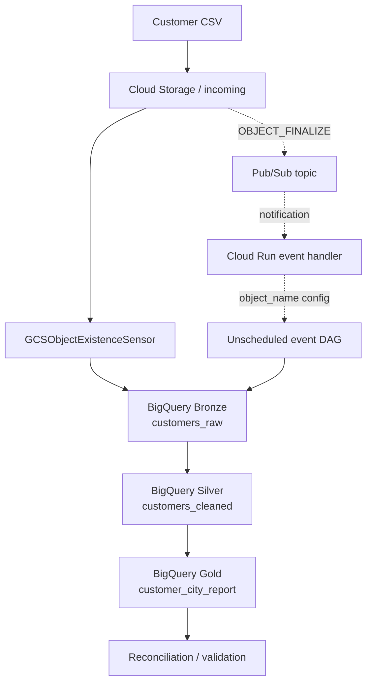

<div align="center">

# ☁️ CloudPulse
### GCP Customer Data Lakehouse

**Terraform • Cloud Storage • Cloud Composer / Apache Airflow • BigQuery • Pub/Sub • Cloud Run**

A hands-on data engineering project demonstrating sensor-based CSV ingestion, a Bronze → Silver → Gold analytics flow, reconciliation, and an event-driven extension.

</div>

---

## Project overview

CloudPulse lands customer CSV files in Google Cloud Storage (GCS), orchestrates processing through Cloud Composer (managed Apache Airflow), and publishes data into BigQuery layers. The primary workflow highlights `GCSObjectExistenceSensor`, which waits for the configured object before allowing downstream ingestion. A separate, unscheduled event DAG demonstrates processing a CSV object name passed in the DAG-run configuration.

### Highlights

- Provision cloud infrastructure with Terraform.
- Use a GCS sensor as the main file-readiness gate.
- Load raw records into Bronze, standardize records in Silver, and aggregate reporting data in Gold.
- Reconcile and inspect the outputs in BigQuery.
- Demonstrate a separate GCS `OBJECT_FINALIZE` → Pub/Sub → Cloud Run → Airflow event path.
- Keep screenshots of actual console, Airflow, and query evidence in `docs/screenshots/`.

## Architecture



The scheduled sensor DAG and event-driven DAG are separate execution paths. The sensor's `poke_interval` controls how often it checks during an active run; it does **not** set how often the DAG starts. The event path only triggers automatically when the notification, Pub/Sub delivery, Cloud Run handler, IAM permissions, and Airflow trigger call are all configured correctly.

## Workflow

1. Upload a CSV to the configured `incoming/` prefix in GCS.
2. Start or wait for a sensor DAG run. `wait_for_csv` checks that the configured object exists.
3. Load the CSV to BigQuery Bronze (`customers_raw`).
4. Clean/standardize the data in Silver (`customers_cleaned`).
5. Aggregate city-level metrics in Gold (`customer_city_report`).
6. Run reconciliation and review task logs.
7. Query the BigQuery tables to confirm results.

## Main feature: GCS sensor

The primary DAG is `customer_lakehouse_sensor_pipeline`. Its sensor task is `wait_for_csv`, configured by default to check `incoming/customers.csv`. Once the object exists, the downstream tasks run in sequence: `load_bronze` → `build_silver` → `build_gold` → `validate_reconciliation`.

### Sensor evidence

**Sensor waits for the raw file**


**Sensor workflow graph**


**Successful pipeline graph**


**Sensor detection logs**


## BigQuery Bronze → Silver → Gold

| Layer | Purpose | Example table |
|---|---|---|
| Bronze | Raw ingested records | `customer_bronze_dev.customers_raw` |
| Silver | Cleaned and standardized records | `customer_silver_dev.customers_cleaned` |
| Gold | City-level reporting / aggregation | `customer_gold_dev.customer_city_report` |

The recorded test run showed **10 Bronze rows, 10 Silver rows, and 4 Gold city-level rows**. These are results from the supplied sample input, not a guarantee for every input file.

### Bronze output


### Silver output


### Gold output


### Reconciliation


## Event-driven extension

The repository also includes `customer_lakehouse_event_pipeline`, an unscheduled DAG that validates an object name supplied in `dag_run.conf` and processes that CSV. The intended chain is: GCS object-finalize notification → Pub/Sub → Cloud Run event handler → Airflow event DAG → Bronze/Silver/Gold → reconciliation. A topic or bucket notification alone is not sufficient to trigger Airflow; the consumer and permissions must also be deployed and connected.

### Event pipeline diagram


### Event pipeline run details


### Successful event DAG run


### Pub/Sub and Cloud Run evidence


## Setup and execution

### Prerequisites

- Google Cloud project with billing enabled.
- `gcloud` CLI authenticated to the target project.
- Terraform and Python installed.
- IAM permissions to enable APIs and create the resources.

### 1. Clone the repository

```bash
git clone https://github.com/cloudwithpavan/cloudpulse-gcp-customer-lakehouse.git
cd cloudpulse-gcp-customer-lakehouse
```

### 2. Authenticate and set the project

```bash
gcloud auth login
gcloud auth application-default login
gcloud config set project YOUR_PROJECT_ID
```

### 3. Configure Terraform variables

Review the variables in `terraform/environments/dev/` and create a local `terraform.tfvars` from the example file if the repository contains one. Set the project ID, region, dataset location, and deployment options. Do not commit private `terraform.tfvars`, credentials, or Terraform state.

### 4. Initialize and validate

Run from PowerShell at the repository root:

```powershell
Set-Location terraform/environments/dev
terraform init
terraform fmt -recursive
terraform validate
terraform plan
```

Review the plan, especially any changes to Composer resources or existing Cloud Storage objects, before applying.

### 5. Apply infrastructure

```powershell
terraform apply
```

Type `yes` only after reviewing the plan. The exact resources created depend on the Terraform configuration and variable values.

### 6. Verify the sensor pipeline

1. Open the Cloud Composer environment and its Airflow UI.
2. Locate and enable `customer_lakehouse_sensor_pipeline`.
3. Upload the expected CSV to the configured `incoming/` object path.
4. Trigger a run or wait for the DAG schedule.
5. Confirm the sensor and downstream tasks succeed.
6. Query Bronze, Silver, and Gold in BigQuery and inspect reconciliation output.

### 7. Verify the event-driven path

1. Confirm the GCS notification and Pub/Sub topic/subscription exist.
2. Confirm the Cloud Run event handler is deployed and receives the notification.
3. Verify its service account permissions for triggering the Airflow DAG.
4. Upload a new CSV and inspect Cloud Run logs and the event DAG run configuration.
5. Confirm downstream task success and validate the BigQuery outputs.

### 8. Run local tests

```powershell
Set-Location ..\..\..
python -m pip install -r requirements-dev.txt
python -m pytest
```

Adapt test commands to the test files included in the checked-out repository.

## Tools and services

- **Google Cloud Storage:** CSV landing zone and object-finalize event source.
- **Cloud Composer / Apache Airflow:** scheduling, sensor checks, and task orchestration.
- **BigQuery:** Bronze, Silver, and Gold storage and SQL transformations.
- **Pub/Sub:** delivery of GCS notifications.
- **Cloud Run:** event consumer / Airflow trigger handler.
- **Terraform:** infrastructure as code.
- **Python and SQL:** pipeline logic, transformations, and validation.
- **Git and GitHub:** source control and project sharing.

## Repository structure

```text
cloudpulse-gcp-customer-lakehouse/
├── cloudrun/
├── dags/
├── data/
├── docs/
│   ├── screenshots/
│   └── architecture.md
├── sql/
├── terraform/
│   ├── environments/dev/
│   └── modules/
├── tests/
├── requirements.txt
├── requirements-dev.txt
├── .gitignore
├── LICENSE
└── README.md
```

## Screenshot index

All selected project evidence is embedded above and also stored under `docs/screenshots/`. The archive additionally preserves the uploaded screenshot originals in `docs/screenshots/original-uploads/` for traceability, including alternate and timestamp-named captures. The GitHub repository page is not used as project execution evidence.

## Security and cost notes

- Cloud Composer can incur significant charges while running. Delete or disable resources when testing is complete, and check billing.
- If you delete Composer manually, reconcile the Terraform configuration/state before running `terraform apply`, or Terraform may recreate it.
- Never commit service-account keys, access tokens, `.terraform/`, Terraform state, local plan files, or private `.tfvars`.
- Keep buckets private and use least-privilege IAM. Review Cloud Run authentication and Airflow trigger permissions before exposing an endpoint.

## Author

**Pavan Kumar** · [GitHub @cloudwithpavan](https://github.com/cloudwithpavan)

---

*CloudPulse — from CSV landing to analytics-ready customer insights.*
