<div align="center">

# ☁️ CloudPulse
### GCP Customer Data Lakehouse

**A Terraform-provisioned customer analytics pipeline on Google Cloud**

`Cloud Storage` · `GCS Sensor` · `Cloud Composer / Airflow` · `BigQuery` · `Pub/Sub` · `Cloud Run`

[Architecture](docs/architecture.md) · [Screenshot Evidence](#10--complete-screenshot-evidence)

</div>

---

## 01 · Project overview

CloudPulse demonstrates an end-to-end customer data pipeline on Google Cloud Platform. Customer CSV data lands in Google Cloud Storage, Apache Airflow orchestrates ingestion and transformations, and BigQuery provides analytics tables organized into **Bronze → Silver → Gold** layers.

> **Main feature — GCS Sensor:** The primary scheduled DAG uses `GCSObjectExistenceSensor` (`wait_for_csv`) to wait for the configured CSV object before downstream processing starts. Sensor-based file detection is a central part of this project and is shown in the execution evidence below.

The project also includes a separate event-driven DAG design for processing a named CSV object supplied in the DAG run configuration.

### Highlights

- Infrastructure managed with Terraform.
- GCS sensor-based file readiness check.
- Cloud Composer-managed Apache Airflow orchestration.
- Bronze, Silver, and Gold data layers in BigQuery.
- SQL-based cleaning and aggregation.
- Reconciliation task and run-level evidence.
- Pub/Sub upload-notification resources and an event-driven DAG.
- Screenshots captured from the working Google Cloud Console and Airflow UI.

## 02 · Architecture

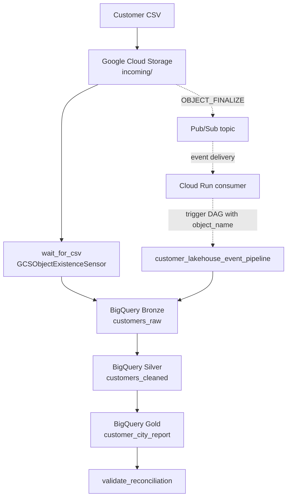

**Important implementation detail:** The scheduled sensor DAG and the event-driven DAG are separate paths. The event path only provides fully automatic upload-to-Airflow execution when the Pub/Sub subscription consumer / Cloud Run handler, authentication, and Airflow trigger permissions are deployed and connected. A topic or notification alone does not trigger Airflow.

## 03 · Data flow

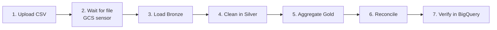

1. Place the CSV in the configured Cloud Storage `incoming/` path.
2. The `wait_for_csv` sensor checks that the target object exists.
3. `load_bronze` ingests source records into BigQuery.
4. `build_silver` applies cleaning and standardization.
5. `build_gold` produces aggregated customer analytics.
6. `validate_reconciliation` runs validation checks.
7. Inspect Airflow task states/logs and query the BigQuery tables.

## 04 · ⭐ Featured: GCS Sensor

| Setting | Project detail |
|---|---|
| DAG | `customer_lakehouse_sensor_pipeline` |
| Sensor task | `wait_for_csv` |
| Operator | `GCSObjectExistenceSensor` |
| Default object | `incoming/customers.csv` |
| Downstream tasks | `load_bronze` → `build_silver` → `build_gold` → `validate_reconciliation` |

The sensor waits for the configured object to exist before the ingestion tasks proceed. The `poke_interval` determines how frequently an active sensor checks for the object; **it is not the DAG's schedule interval**. The schedule that starts the DAG is configured independently.

### Sensor execution evidence

**Airflow DAG list**

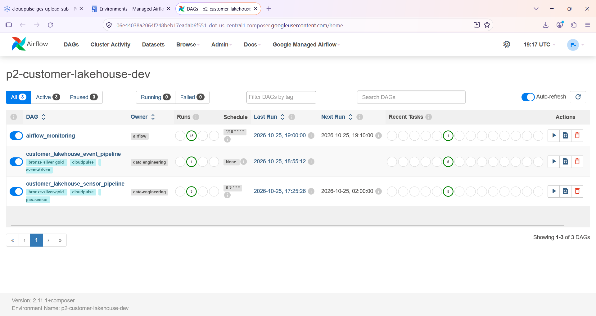

**Successful sensor run and task graph**


**Sensor task logs**

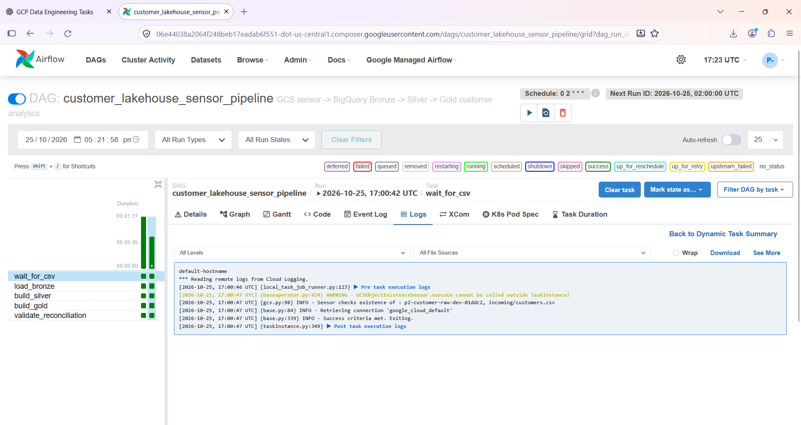

## 05 · Bronze → Silver → Gold

| Layer | Role | Table |
|---|---|---|
| **Bronze** | Raw ingested customer rows | `customer_bronze_dev.customers_raw` |
| **Silver** | Cleaned and standardized customer rows | `customer_silver_dev.customers_cleaned` |
| **Gold** | City-level analytics | `customer_gold_dev.customer_city_report` |

One captured test run showed **10 Bronze rows, 10 Silver rows, and 4 Gold rows**. These are the results for that test input, not fixed counts for every future upload.

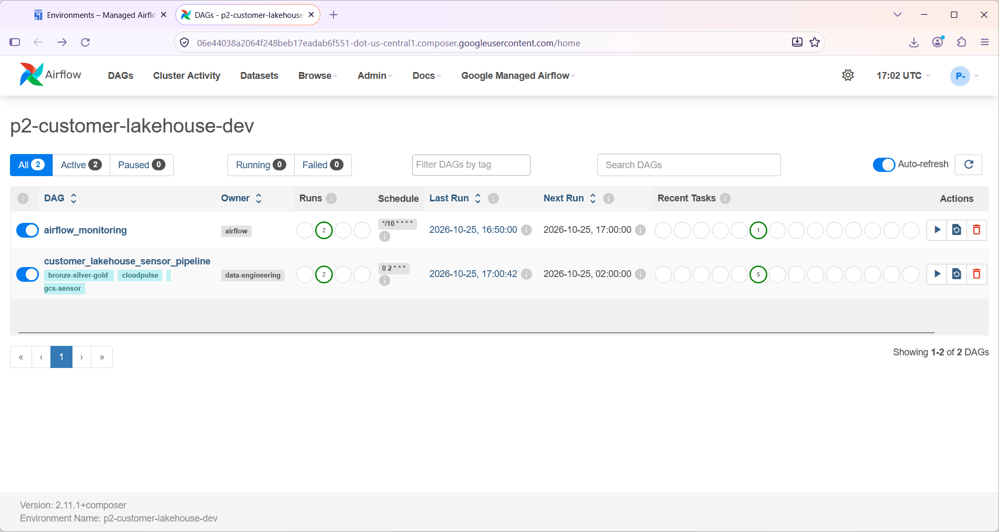

## 06 · Event-driven extension

The separate `customer_lakehouse_event_pipeline` DAG is unscheduled and accepts an uploaded object name in its DAG-run configuration.

Expected event path:

1. Cloud Storage emits an `OBJECT_FINALIZE` notification.
2. Pub/Sub receives the notification.
3. A subscription consumer such as Cloud Run processes the message.
4. The consumer triggers the event DAG with `object_name`.
5. The DAG validates the object path and runs Bronze → Silver → Gold → reconciliation.

Evidence screenshots include Pub/Sub subscription details, Cloud Logging, and the event DAG view.

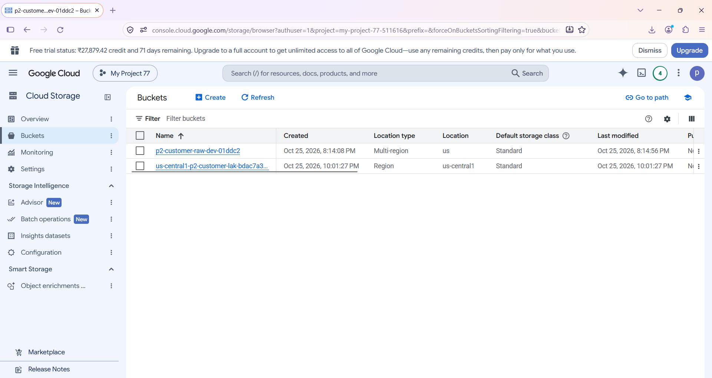

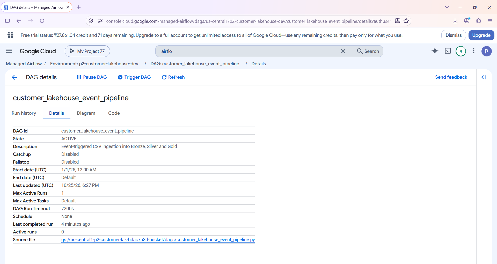


## 07 · Tools and services

- **Google Cloud Storage** — CSV landing zone and object-finalize event source.
- **Cloud Composer / Apache Airflow** — DAG scheduling, sensor, task orchestration, and logs.
- **BigQuery** — analytical warehouse and Bronze/Silver/Gold datasets.
- **Pub/Sub** — message topic for storage notifications.
- **Cloud Run** — intended event consumer and Airflow trigger component.
- **Terraform** — infrastructure as code.
- **Python** — DAG logic, event handling, and validation.
- **SQL** — transformations and aggregations.
- **Git / GitHub** — version control and project documentation.

## 08 · Repository structure

```text
cloudpulse-gcp-customer-lakehouse/
├── .github/
├── cloudrun/
├── dags/
│   ├── customer_lakehouse_sensor_pipeline.py
│   └── customer_lakehouse_event_pipeline.py
├── data/
├── docs/
│   ├── architecture.md
│   └── screenshots/
├── sql/
├── terraform/
│   ├── environments/dev/
│   └── modules/
├── tests/
├── requirements.txt
├── requirements-dev.txt
├── .gitignore
├── LICENSE
└── README.md
```

## 09 · Deployment guide

### Prerequisites

- A Google Cloud project with billing enabled.
- `gcloud` CLI, Terraform, and Python installed.
- Permissions to enable APIs and provision the project's resources.

### Step 1 — Clone

```bash
git clone https://github.com/cloudwithpavan/cloudpulse-gcp-customer-lakehouse.git
cd cloudpulse-gcp-customer-lakehouse
```

### Step 2 — Authenticate

```bash
gcloud auth login
gcloud auth application-default login
gcloud config set project YOUR_PROJECT_ID
```

### Step 3 — Configure Terraform

Review the variables in `terraform/environments/dev/`. Create a local `terraform.tfvars` using the variable definitions as a guide. Use your own project ID and appropriate region/location values. Do not commit private configuration.

### Step 4 — Initialize and validate

Run these commands from the repository root in PowerShell:

```powershell
Set-Location terraform/environments/dev
terraform init
terraform fmt -recursive
terraform validate
terraform plan
```

Review every proposed change, especially changes to existing Cloud Storage objects or Composer resources, before applying.

### Step 5 — Apply

```powershell
terraform apply
```

Confirm the plan is correct before typing `yes`. Resource creation can take time, especially Cloud Composer.

### Step 6 — Verify the GCS Sensor pipeline

1. Open the Cloud Composer environment in Google Cloud Console.
2. Open the Airflow UI and find `customer_lakehouse_sensor_pipeline`.
3. Confirm it is active.
4. Upload the configured CSV object.
5. Trigger a run or wait for its configured schedule.
6. Confirm all five tasks succeed.
7. Query the Bronze, Silver, and Gold tables in BigQuery.

### Step 7 — Verify event-driven execution

1. Verify the Pub/Sub topic and Cloud Storage notification.
2. Verify the consumer / Cloud Run service is deployed and subscribed.
3. Verify IAM permissions allow event receipt and Airflow DAG triggering.
4. Upload a new CSV and inspect consumer logs.
5. Confirm the event DAG run contains the correct `object_name`.
6. Confirm downstream tasks and BigQuery outputs.

### Step 8 — Tests

```powershell
Set-Location ..\..\..
python -m pip install -r requirements-dev.txt
python -m pytest
```

Run the tests configured in the repository; not every project includes a test suite with the same command.

## 10 · Complete screenshot evidence

All 20 evidence screenshots are embedded below. They should display directly in this README on GitHub; readers do not need to open separate image links.

### Google Cloud Composer environment

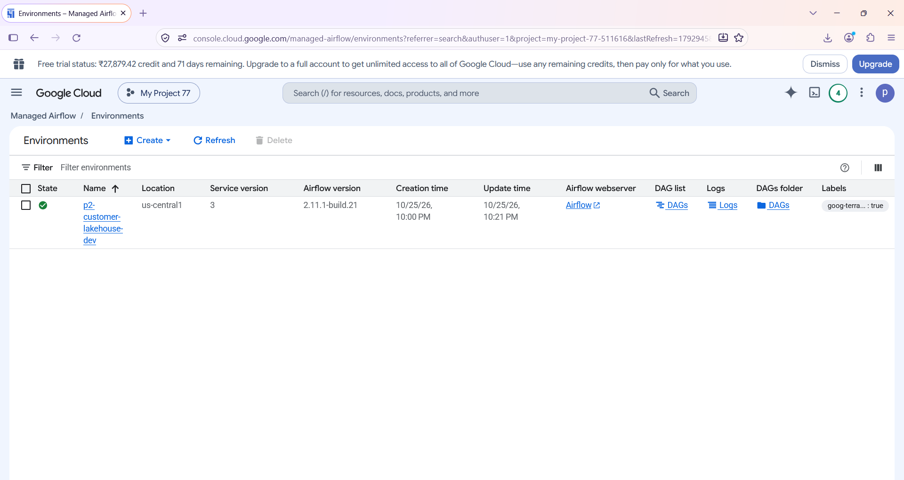

### Airflow DAGs overview


### Sensor DAG run summary

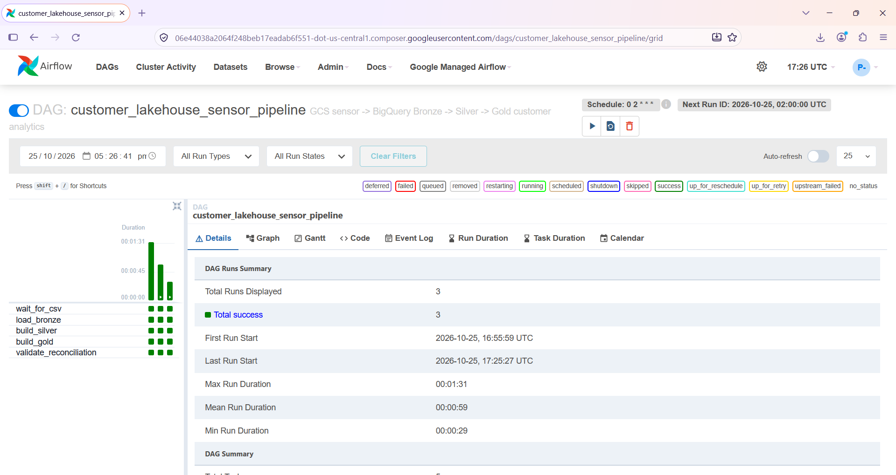

### Latest sensor DAG run summary

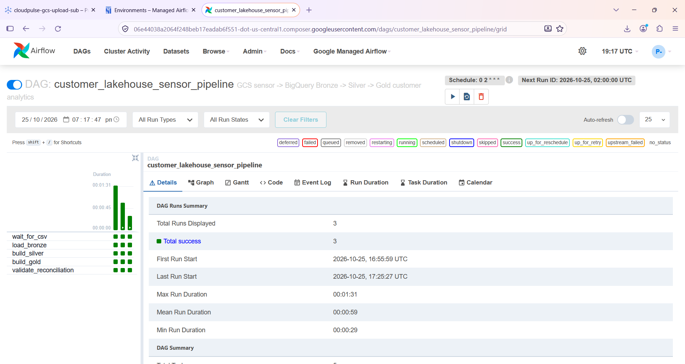

### Sensor pipeline task graph


### Sensor task logs


### BigQuery Bronze, Silver, and Gold results


### Pub/Sub subscription configuration


### Cloud Logging evidence

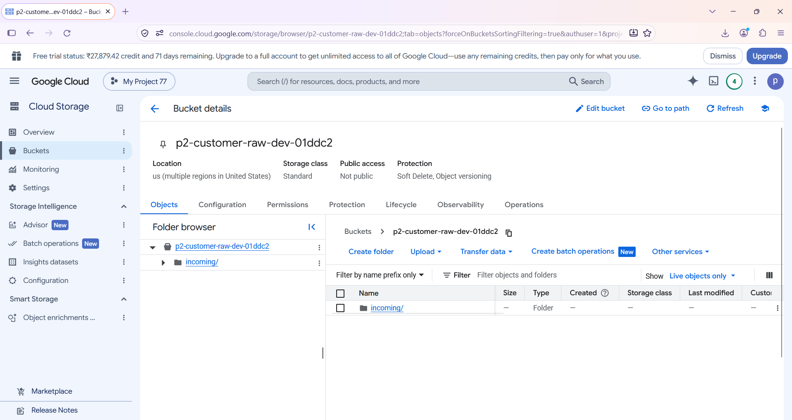

### Pub/Sub topic in Google Cloud Console


### Event-driven DAG details


### Event-driven DAG architecture


### Event-driven DAG run history

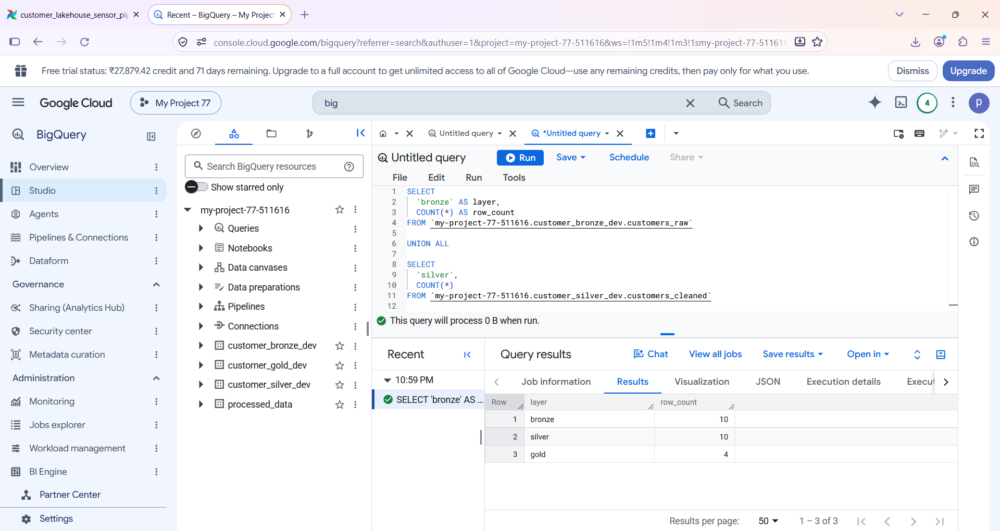

### Successful event-driven DAG run


### Sensor task details


### Successful sensor pipeline run

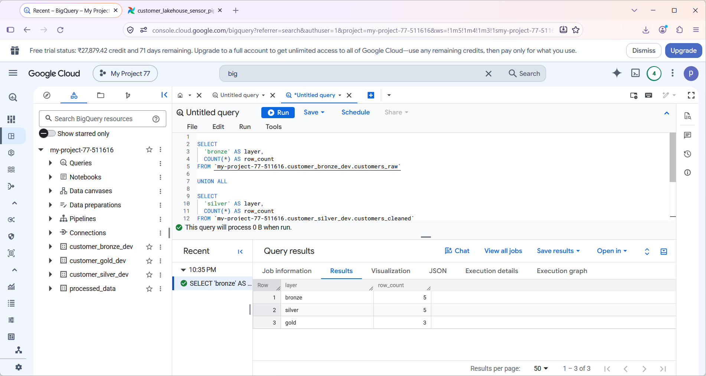

### CSV upload to Cloud Storage


### CSV object in the incoming bucket path


### Composer Airflow UI

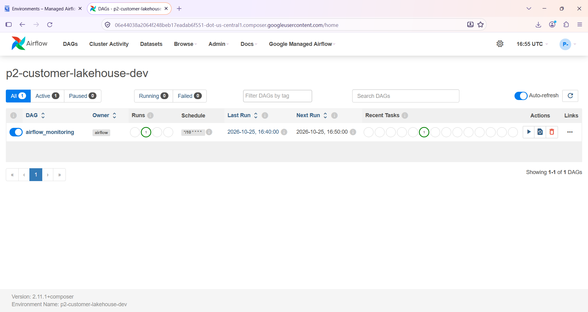

### GitHub repository evidence

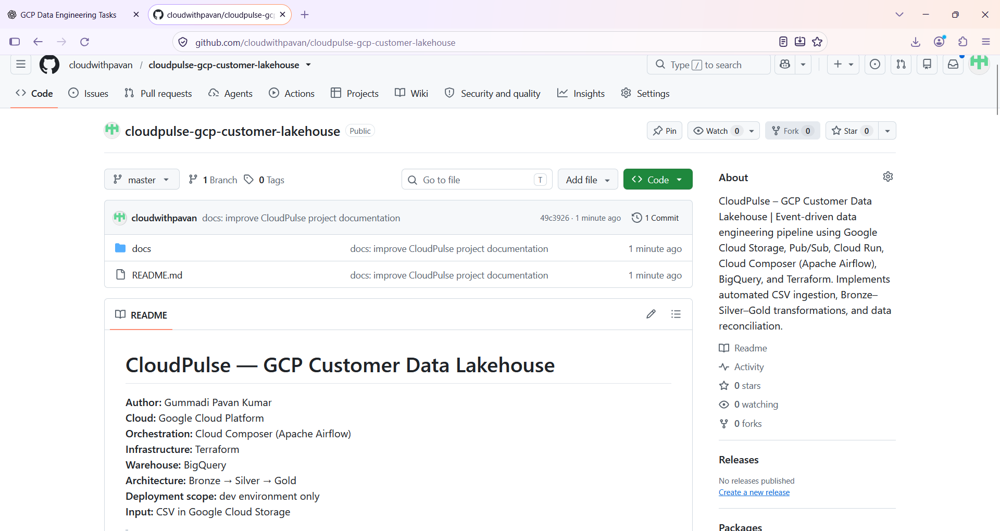

## 11 · Security and cost considerations

- Do not commit `.terraform/`, Terraform state files, plan files, credentials, service-account keys, or private `terraform.tfvars`.
- Use least-privilege IAM and keep buckets private.
- Protect the event handler and its Airflow trigger endpoint.
- **Cloud Composer can incur ongoing charges.** Monitor billing and clean up unused resources when finished testing. Inspect Terraform state and dependencies before destroying infrastructure.

## Author

**Gummadi Pavan Kumar**  
GitHub: [@cloudwithpavan](https://github.com/cloudwithpavan)

---

<div align="center">

*CloudPulse — From CSV landing to analytics-ready customer insights.*

</div>
