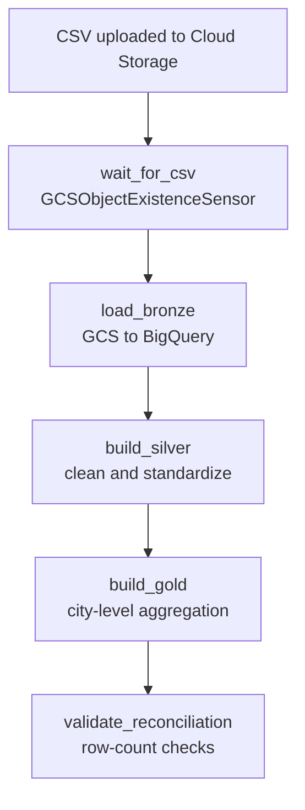
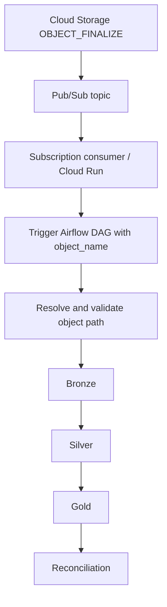

# CloudPulse Architecture Notes

## Primary scheduled sensor pipeline

The sensor waits for the configured object to exist before downstream tasks proceed. Sensor polling interval and DAG scheduling interval are separate settings.

## Event-driven pipeline

The event-driven pipeline requires the subscription consumer and Airflow trigger permissions to be correctly deployed. A topic and notification alone do not trigger an Airflow DAG.

## Screenshot index

See [`screenshots/`](screenshots/) for ordered evidence. The README embeds the main screenshots.
