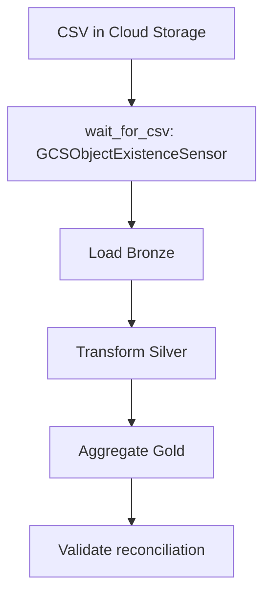
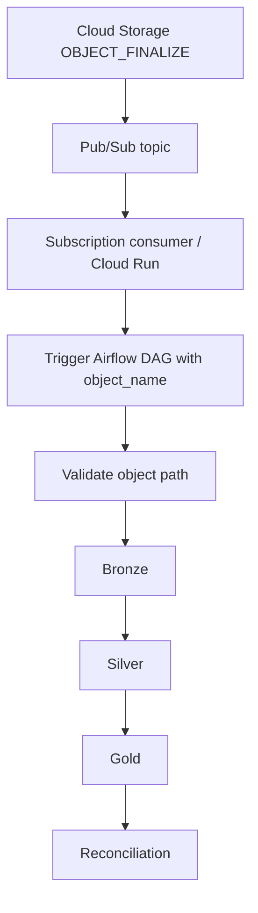

# CloudPulse — Architecture

## Scheduled sensor pipeline

## Event-driven extension

The sensor pipeline and event-driven pipeline are separate DAGs. The event-driven path requires the Pub/Sub consumer and permissions to be deployed and connected; a topic/notification by itself does not trigger Airflow.
