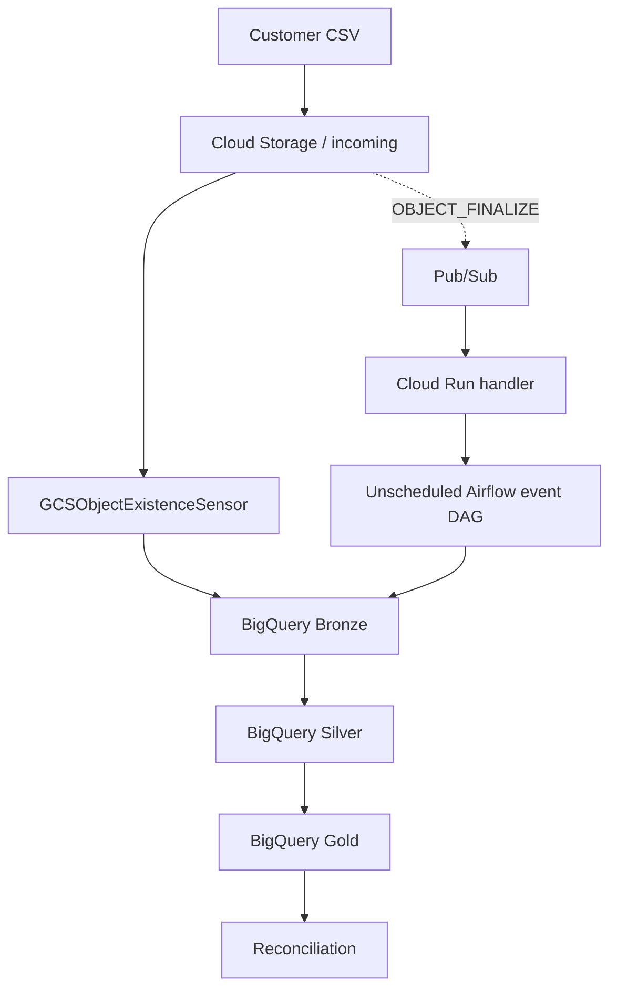

# CloudPulse Architecture

The sensor DAG is scheduled separately from the event-driven DAG. The event path requires a working notification, Pub/Sub delivery, Cloud Run handler, IAM configuration, and Airflow DAG-trigger call.
